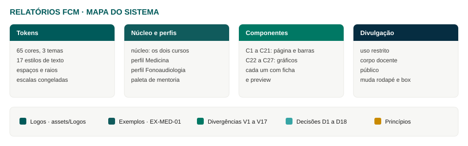

# Sobre este sistema

Página de entrada, na estrutura da página «About» do kit do Carbon Design System (missão, benefícios, descontinuação, migração, contatos, diretório), com o conteúdo adaptado a este sistema. As cores e as regras seguem os tokens daqui; nada do Carbon visual foi importado. Proposta de trabalho, ainda não validada pelo Napes.

## Missão

Padronizar a aparência e as regras de leitura dos Relatórios de Avaliação dos Cursos da FCM-Unicamp, para que Medicina, Fonoaudiologia e os ciclos seguintes saiam do Napes com a mesma identidade, os mesmos gráficos e o mesmo cuidado com quem respondeu.

## Quem ganha o quê

| Quem | Ganho |
|---|---|
| Equipe do Napes que monta o relatório | Componentes e tokens prontos e aprovados; não redesenha cada página. |
| Quem revisa | Regras verificáveis (escalas, rótulos, notas, níveis de divulgação) em vez de juízo caso a caso. |
| Quem produz o arquivo final (Word, Adobe, HTML) | Valores exatos por nome de token, em três temas de divulgação. |
| Cursos novos | Entram como perfil sobre o mesmo núcleo, sem refazer a base. |

## Um arquivo, três temas

Como o Carbon consolidou seus temas em um arquivo com modos de variável, este sistema mantém um conjunto de tokens e três temas de divulgação (restrito, docente, público). Trocar o tema muda rodapé, box do Resumo Executivo e presença dos comentários sensíveis. Não muda a estrutura das páginas nem as cores de escala.

## Descontinuação

- O kit anterior (`guia-de-estilo.md`, `tokens.json`, `base.css`, `guia-visual.html`) deixa de receber atualização quando a decisão D1 for tomada. Até lá ele segue como referência e as divergências estão em Divergências (V1 a V17).
- Nenhum arquivo é apagado na troca: o que sai de uso vai para uma pasta de arquivados, com data.

## Migração de um relatório existente para o sistema

Adaptado dos passos de migração do Carbon.

1. Comece pelas páginas com menos dependências (capa, contracapas, sumário).
2. Trabalhe numa cópia de teste; compare com o EX-MED-01 página a página.
3. Escolha uma página complexa (disciplina) como referência do que pode quebrar.
4. Troque valores soltos por tokens; anote o que não tem token equivalente e registre como divergência.
5. Repita por tema de divulgação usado.
6. Procure sobreposições indevidas: cor aplicada à mão, fonte fora de `titulo` e `corpo`.
7. Repita para cada seção do relatório e valide o conjunto.
8. Publique o relatório migrado, avise a equipe e arquive o anterior.

## Contatos

Fonte: portal da FCM e assinaturas do EX-MED-01.

| Nome | Papel |
|---|---|
| Profª Drª Eliana Martorano Amaral | Coordenadora do Napes |
| Dr. Ugo Caramori | Assessor em Educação das Profissões da Saúde |
| Mônica Rovigati | Profissional para Assuntos Administrativos |
| Diogo Dourado Vieira | Profissional para Assuntos Administrativos |

E-mail do núcleo: napes@unicamp.br.

## Diretório do projeto

| Onde | O que há |
|---|---|
| `README.md` | Como aplicar, fundamentos de conteúdo e visuais, identidade. |
| `01` a `05` | Arquitetura, perfis de curso, regras de visualização, níveis de divulgação, modelos de página. |
| `06` a `08` | Divergências V1 a V17, extensões de 2026.2, decisões D1 a D18. |
| `09` | Exemplos de referência (EX-MED-01). |
| `10` | Princípios de design (proposta). |
| `components/` | C1 a C27, cada um com ficha e preview. |
| `assets/Logos/` | Logos da Unicamp, FCM e Napes, com as regras de uso. |
| `fonts/` | Google Sans Flex (cortes da capa). |
